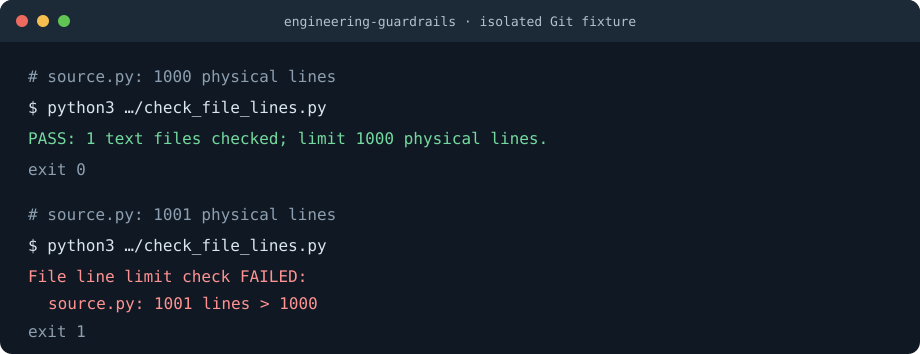

# engineering-guardrails

[](LICENSE)
[](https://www.python.org/)
[](#features)

**English** | [中文](./README.zh-CN.md)

Reusable engineering constraints for coding agents. Combine short global instructions,
a shared skill, and repository-local checks covering **file size, complexity, module
boundaries, tests, and review**. Verify actual staged or committed code—not just a passing
working copy.

The skill uses Markdown and portable Python tools. It does not prescribe a framework,
microservices, or the same architecture for every project.

## Demo



The diagram reproduces checker output from an isolated Git fixture. The workflow is
simple: load the rules, establish project-local checks, and verify that deliberate
violations actually fail.

## Quick start

Requirements: Python 3.12+, Git, and a POSIX shell for the optional Git hooks.

When the skill destination does not already exist:

```bash
git clone https://github.com/hotalexnet/engineering-guardrails.git \
  ~/.agents/skills/engineering-guardrails
```

Bootstrap an existing, independent Git repository:

```bash
python3 ~/.agents/skills/engineering-guardrails/scripts/init_project.py \
  --repo /absolute/path/to/project

cd /absolute/path/to/project
# Declare existing application modules in quality-gates.json before checking them.
python3 scripts/check_quality.py

# Review existing hooks before enabling repository-local automation.
python3 scripts/install_hooks.py
```

Pi discovers the skill under `~/.agents/skills/`. Run `/reload` in an existing session,
or load it explicitly with `/skill:engineering-guardrails`.

## What gets installed

The clone places one skill under `~/.agents/skills/engineering-guardrails/`.
The project initializer then copies a self-contained gate kit into the target repository:

- `scripts/` — line, Python complexity/dependency checks, the quality entry point, and hook setup.
- `quality-gates.json` — Python source roots, module ownership, allowed layers, branch-score limit, and nesting warning threshold.
- `.githooks/` — staged-snapshot and outgoing-tip checks.
- `tests/` — regression tests for the gate tools and deliberately invalid changes.
- `docs/` — gate rules, a concrete review/test-matrix template, and an integration guide.
- `examples/` — GitHub Actions and GitLab CI templates; neither is automatically enabled.

The initializer checks all destinations before copying and refuses conflicting content.
It does not modify `AGENTS.md`, install dependencies, stage files, commit, or push.
The copied tools do not depend on this skill checkout or a particular user's home directory.

## Commands

Run these commands from the target repository root after initialization.

| Need | Command |
| --- | --- |
| Check working files and run tool tests | `python3 scripts/check_quality.py` |
| Check the complete staged snapshot and its tests | `python3 scripts/check_quality.py --staged` |
| Check a specific committed snapshot | `python3 scripts/check_quality.py --revision HEAD` |
| Check file lengths only | `python3 scripts/check_file_lines.py` |
| Check Python complexity, nesting warnings, and declared dependencies | `python3 scripts/check_python_design.py` |
| Enable repository-local hooks | `python3 scripts/install_hooks.py` |
| Inspect the active hook configuration | `git config --show-origin --get core.hooksPath` |

`pre-commit` checks the full staged snapshot. `pre-push` checks each outgoing reference's
local tip, excluding deletions; it deduplicates identical SHAs and does not replay every historical commit.

Optional `commands` in `quality-gates.json` run additional argv-array commands, without a shell,
inside the same working tree or snapshot. This is the entry point for frontend lint and test tools;
nonzero exits block the gate. Snapshot dependencies must be prepared explicitly—not borrowed
from the working copy. See the [integration guide](./assets/project-kit/docs/integration-guide.md).

## Features

- **1000-line limit:** handwritten program files may contain at most 1000 physical lines,
  including blank lines, comments, and embedded templates. Do not bypass the rule through
  minification, extension changes, or meaningless numbered fragments.
- **Broad file coverage:** the checker covers non-document text files, including
  configuration, tracked files, and untracked files not ignored by Git. `.md`, `.rst`, and
  binary files are not counted. Tracked files cannot hide behind a new ignore rule.
- **Snapshot-aware testing:** staged and committed tests run in temporary exports, so an
  unstaged fix cannot hide a staged failure.
- **Failure-case verification:** tests deliberately inject oversized files, failing tests,
  missing gate files, and empty test suites.
- **Non-overwriting setup:** initializers and hook installers stop at conflicting setups
  instead of replacing them.
- **Function complexity:** Python functions default to a maximum AST branch score of 15.
  This is a project default—not an industry standard or a claim of equivalence to Radon/Sonar.
  Nested functions and lambdas are measured independently; see the [metric definition](./references/project-gates.md)
  and [scored examples](./assets/project-kit/docs/engineering-gates.md#复杂度与模块边界).
- **Nesting-depth warnings:** report maximum control-block depth separately from the branch score.
  Depth above 4 warns by default; it does not change the exit status or block hooks.
  `elif` stays at the same depth and nested functions are measured independently.
- **Declared module boundaries:** configure source roots, layer ownership and allowed imports.
  Unowned modules, forbidden cross-layer imports and static import cycles fail checks.
  The starter configuration covers the gate tools; declare actual application modules as they are added.
- **Tests and review together:** record normal, forbidden, failure and relevant concurrency paths
  in the [review checklist](./assets/project-kit/docs/change-review.md). Name the independent reviewer
  and conclusion, or explicitly state that no independent review occurred. Coverage percentages
  and green checks do not replace behavioral evidence or review.

## Python complexity: blocking vs. advisory

The two metrics are complementary, not a claim of standard cyclomatic or cognitive complexity:

| Metric | Configuration under `python` | Default | When exceeded |
| --- | --- | --- | --- |
| AST branch score | `max_function_complexity` | 15 | Fails the check |
| Maximum control-block depth | `max_nesting_depth` | 4 | Warns only |

Both keys belong in the existing `python` object in `quality-gates.json`; retain its source roots
and layer declarations. Older configurations without `max_nesting_depth` also default to 4.
The nesting threshold must be a positive integer; invalid configuration still fails the check.

Function-level depth starts at 0. `if`, loops, `with`, `try`/`try*`, and `match` add a level,
including async variants. `else`, `except`, `finally`, and `case` do not add another level;
an explicit `if` inside `else` does. Expressions and comprehensions do not contribute to this
control-block depth; their decisions remain covered by the branch score.

Depth 4 produces no warning; depth 5 produces a diagnostic such as:

```text
WARNING: src/app.py:1: run nesting depth 5 > 4 (advisory only)
```

Staged and committed checks use the code and configuration from that snapshot. Treat 4 as an
initial warning threshold to validate against real project samples, not an industry standard.
Review readability and false positives before considering a separately approved blocking rule;
do not mechanically extract functions just to remove warnings. Full definitions and examples
are in the [project rules](./assets/project-kit/docs/engineering-gates.md#复杂度与模块边界).

## How the gates work

```text
Short global instructions   when to load the skill and which defaults apply
SKILL.md                    inspect, implement, verify, and report honestly
Repository-local scripts    file size, Python complexity/dependencies, and tests
Local Git hooks             check the actual staged or outgoing snapshot
Remote CI and protection    separate setup required for enforced merging
```

Instructions guide behavior; checks supply evidence. Neither a skill nor a local hook is
an unbypassable control. See [the gate reference](./references/project-gates.md) for details.

## Install and upgrade

Discovery does not mean the full skill is always loaded. Append short instructions to
`~/.pi/agent/AGENTS.md`; do not replace existing configuration:

```markdown
## Engineering constraints
- Before project setup, code changes/refactoring, gate setup, or delivery, read and follow
  ~/.agents/skills/engineering-guardrails/SKILL.md.
- Keep program files within 1000 physical lines, including blank lines and comments.
  Do not compress code to bypass the limit.
- Establish repository-local checks for new projects; inspect legacy projects first.
- Report actual verification results. Local hooks are not remote enforcement.
```

To update a clean skill checkout:

```bash
git -C ~/.agents/skills/engineering-guardrails status --short
git -C ~/.agents/skills/engineering-guardrails pull --ff-only
```

Save or resolve local changes before pulling. Already-copied project tools do not update
automatically: review and integrate differences, then rerun tests. The initializer refuses
to overwrite different content.

## Cross-agent and multi-machine use

The skill's instructions and project tools are portable, but discovery paths and global
instruction files depend on the agent. Pi's behavior is not a compatibility guarantee
for every harness.

On another machine, clone the skill into the supported skill directory and configure the
global instruction entry point. Projects keep their own copied checks under version control.
After cloning a project, review and explicitly enable its hooks; Git does not enable them
automatically.

## Privacy and Git policy

This repository contains no machine-wide configuration, business data, or credentials.
The tools do not automatically modify remote settings or authorize commits, pushes, or deployments.

Keep project-local environments, credentials, dependencies, and generated artifacts out of
Git. Review gate code, tests, and any exemptions as carefully as application changes;
do not silently relax thresholds to make a check pass.

## Limitations

- Skills and global instructions guide agents; local hooks can be bypassed.
- Python checks inspect AST functions and static imports only. Configure corresponding tools
  for other languages; dynamic imports, SQL writes and interface design still require review.
- Remote enforcement requires separately configured CI, required checks, and branch protection.
- The kit checks declared Python dependencies, not every architectural coupling. It does
  **not** automatically implement permission, workflow, data-access or concurrency tests.
- The review template cannot approve a change. High-risk changes need independent review;
  do not label the implementer's self-check as someone else's approval.
- Add application tests and language-specific checks to the project entry point. Tool tests
  are not application acceptance.
- Inspect legacy projects before changing them; follow the [inventory and migration steps](./assets/project-kit/docs/integration-guide.md#4-旧项目渐进接入).
  There is no automatic baseline/exemption or `--diff` mode. Do not raise the global 1000-line cap to hide debt.
- Every CLI explicitly requires Python 3.12+. Hooks require a POSIX shell; native Windows installation
  is rejected in favor of WSL2. Junction protection has simulated tests, not native Windows acceptance.
- JS/TS ESLint examples and GitLab templates need validation in the target project; they are not
  claimed as end-to-end tested frontend or GitLab integrations.

## Development

Run tests and static checks from this skill repository's root:

```bash
python3 assets/project-kit/scripts/check_file_lines.py
python3 assets/project-kit/scripts/check_python_design.py
python3 -m unittest discover -s tests -p 'test_*.py' -v
python3 -m unittest discover -s assets/project-kit/tests -p 'test_*.py' -v
git diff --check
```

These are the skill repository's development commands. `scripts/check_quality.py` is the
entry point in an initialized target project, not at the skill repository root. Tests cover
the depth-4/5 boundary, `elif`, independent scopes, configuration validation, and a real hook
that uses snapshot code/configuration while allowing nesting warnings.

Tests use isolated temporary Git repositories; they do not create fixture commits in
application branches. The Python tools use only the standard library.

[GitHub Actions](./.github/workflows/quality.yml) runs these checks on pushes and pull
requests with Python 3.12 and 3.13. A workflow is not branch protection: required checks
and independent approvals must still be configured on the hosting platform.

For a target project, start from the [GitHub](./assets/project-kit/examples/github-actions-quality.yml)
or [GitLab](./assets/project-kit/examples/gitlab-ci-quality.yml) template and review its runtime and
locked dependencies. The [review response](./docs/review-response.md) records which reported issues
were reproduced, corrected, already covered, or deliberately deferred.

## Project structure

```text
engineering-guardrails/
├── SKILL.md
├── references/project-gates.md
├── scripts/init_project.py
├── quality-gates.json
├── .github/                        # CI and pull-request review template
├── assets/
│   ├── demo.svg
│   └── project-kit/
│       ├── scripts/
│       ├── .githooks/
│       ├── tests/
│       ├── examples/                # CI templates copied to the target project
│       ├── quality-gates.json
│       └── docs/                    # gate rules and change-review checklist
├── tests/test_init_project.py
├── README.md
├── README.zh-CN.md
└── LICENSE
```

## License

[MIT License](LICENSE)
