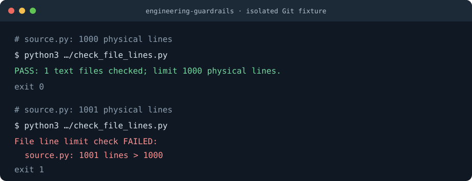

# engineering-guardrails

[](LICENSE)
[](https://www.python.org/)
[](#主要功能)

[English](./README.md) | **中文**

面向编码 Agent 的通用工程约束工具。通过全局简规则、通用 Skill 和项目自动门禁，
同时约束**文件规模、复杂度、模块边界、测试和评审**，验证实际暂存或提交的代码，
而不只是工作区测试通过。

Skill 使用 Markdown 和可移植的 Python 工具，不强制框架、微服务，
也不要求每个项目采用同一种架构。

## 演示



图中复现了独立临时 Git 仓库中的实际检查输出。基本流程很简单：加载规则，
建立项目检查，再用故意违规的反例确认门禁确实会失败。

## 快速开始

前置要求：Python 3.12+、Git；可选 Git hook 需要 POSIX shell。

在 Skill 目标目录尚不存在时：

```bash
git clone https://github.com/hotalexnet/engineering-guardrails.git \
  ~/.agents/skills/engineering-guardrails
```

为已有的独立 Git 仓库建立门禁：

```bash
python3 ~/.agents/skills/engineering-guardrails/scripts/init_project.py \
  --repo /absolute/path/to/project

cd /absolute/path/to/project
# 检查已有 Python 业务代码前，先在 quality-gates.json 声明实际模块。
python3 scripts/check_quality.py

# 审核已有 hook 后，再启用本仓库的自动门禁。
python3 scripts/install_hooks.py
```

Pi 支持发现 `~/.agents/skills/` 下的 Skill。当前会话执行 `/reload`，
也可通过 `/skill:engineering-guardrails` 显式加载。

## 安装了什么

克隆后，`~/.agents/skills/engineering-guardrails/` 中有一个完整 Skill。
项目初始化器会向目标仓库复制一套自包含门禁：

- `scripts/`：行数、Python 复杂度／依赖检查、统一质量入口和 hook 安装器。
- `quality-gates.json`：Python 源码根、模块归属、允许依赖及复杂度阈值。
- `.githooks/`：暂存快照及待推送 tip 检查。
- `tests/`：门禁工具及故意违规场景的回归测试。
- `docs/`：门禁规则、带示例的变更评审和测试矩阵、具体接入指南。
- `examples/`：GitHub Actions 和 GitLab CI 模板，不自动启用或覆盖流水线。

初始化器复制前预检全部目标，遇到冲突内容即停止，不修改 `AGENTS.md`，
不安装依赖、不暂存、不提交、不推送。
复制后的工具不依赖这个 Skill 仓库或某个使用者的主目录运行。

## 常用命令

初始化后，从目标仓库根目录执行。

| 需求 | 命令 |
| --- | --- |
| 检查工作区并运行工具测试 | `python3 scripts/check_quality.py` |
| 检查完整暂存快照及其测试 | `python3 scripts/check_quality.py --staged` |
| 检查指定提交快照 | `python3 scripts/check_quality.py --revision HEAD` |
| 只检查文件行数 | `python3 scripts/check_file_lines.py` |
| 检查 Python 复杂度和声明的依赖 | `python3 scripts/check_python_design.py` |
| 启用仓库本地 hook | `python3 scripts/install_hooks.py` |
| 查看当前 hook 配置 | `git config --show-origin --get core.hooksPath` |

`pre-commit` 检查完整暂存快照。`pre-push` 检查待推送引用的本地 tip，
删除引用除外，相同 SHA 去重，不逐个回放全部历史提交。

`quality-gates.json` 可选的 `commands` 以 argv 数组运行额外工具，不调用 shell，
在同一工作区或快照执行，非零结果阻断门禁。前端 lint／测试通过该入口接入；
快照依赖必须显式准备，不能借用工作区源码。具体见[接入指南](./assets/project-kit/docs/integration-guide.md)。

## 主要功能

- **1000 行上限：** 手写程序文件最多1000物理行，空行、注释和内嵌模板均计入。
  不得通过压缩代码、改变后缀或拆成无职责的编号文件绕过。
- **覆盖不同文件：** 检查非文档文本文件，包括配置、已跟踪文件和未被 Git 忽略的新文件。
  `.md`、`.rst` 文档及二进制不计行数；已跟踪文件不能通过新加忽略规则逃避检查。
- **按快照验证：** 暂存和提交快照在临时导出目录运行测试，不能用未暂存修复掩盖暂存失败。
- **验证失败路径：** 测试主动注入超限文件、失败测试、门禁文件缺失及空测试集。
- **不覆盖已有配置：** 初始化器及 hook 安装器遇到冲突即停止，不接管已有其他门禁。
- **函数复杂度：** Python 函数默认 AST 分支分数最多15，这是项目默认值，不是行业标准，
  也不宣称与 Radon／Sonar 完全等价。嵌套函数和 lambda 独立度量，见[度量定义](./references/project-gates.md)
  和[带分数的示例](./assets/project-kit/docs/engineering-gates.md#复杂度与模块边界)。
  另报控制块嵌套深度：`python.max_nesting_depth` 默认4，超过仅警告、不阻断；elif 同层，嵌套函数独立，表达式不计控制块深度，完整口径见上述文档。
- **声明模块边界：** 配置源码根、模块所属层和允许依赖。未归属模块、未授权跨层导入及静态循环会失败。
  初始配置描述门禁工具本身，增加业务模块时必须声明实际边界。
- **测试与评审结合：** 按[评审清单](./assets/project-kit/docs/change-review.md)记录正常、禁止、异常和适用的并发路径。
  写明独立评审人及结论，或明确“未独立评审”；覆盖率百分比和检查全绿不代替行为证据或人工评审。

## 门禁如何工作

```text
全局简规则          何时加载 Skill，默认约束是什么
SKILL.md            检查上下文、实现、验证并如实报告
项目内检查脚本      文件规模、Python 复杂度／依赖及测试
本地 Git hook       自动检查真实暂存或待推送快照
远端 CI 和分支保护  需要另行配置，才能强制限制合并
```

指令指导行为，检查提供证据。Skill 和本地 hook 都不是不可绕过的强制执行器。
机制详见 [门禁参考文档](./references/project-gates.md)。

## 安装和升级

发现 Skill 不等于始终加载全文。建议向 `~/.pi/agent/AGENTS.md` 追加简规则，
不要覆盖已有配置：

```markdown
## 工程约束
- 新项目、代码修改／重构、门禁建立和交付前，先读取并遵循
  ~/.agents/skills/engineering-guardrails/SKILL.md。
- 程序单文件最多1000物理行，包含空行与注释，不得靠压缩代码绕过。
- 新项目建立仓库内检查；旧项目先评估，不自动批量改造。
- 只报告实际验证结果，不将本地 hook 称为远端强制门禁。
```

更新干净的 Skill 工作区：

```bash
git -C ~/.agents/skills/engineering-guardrails status --short
git -C ~/.agents/skills/engineering-guardrails pull --ff-only
```

拉取前先保存或处理本地修改。已复制到项目中的工具不会自动更新：
需审查差异、针对性整合并重新测试。初始化器不会覆盖不同内容。

## 跨 Agent 和多机器使用

Skill 指令和项目工具可移植，但技能发现目录及全局指令入口取决于代理工具。
Pi 的加载行为不代表已经验证所有工具兼容。

在另一台机器上，把 Skill 克隆到对应工具支持的目录，并配置全局指令入口。
项目自己的检查脚本随仓库管理。克隆项目后，应先审核再显式启用 hook；
Git 不会自动启用它们。

## 隐私和 Git 建议

本仓库不包含本机全局配置、业务资料或凭据。工具不自动修改远端设置，
也不自动取得提交、推送或部署授权。

项目环境、凭据、依赖及生成产物不应进入 Git。门禁实现、测试及豁免项与业务代码一样需要评审，
不能为了检查通过而静默放宽阈值。

## 限制

- Skill 和全局约定是代理指导，本地 hook 可以绕过。
- 远端强制约束需要另行配置 CI、必要检查及分支保护。
- Python 检查只覆盖 AST 函数及静态导入，其他语言需配置对应工具；动态导入、SQL 写入和接口设计仍需评审。
- 工具包检查声明的 Python 依赖，不等于识别所有架构耦合；**没有自动实现权限、业务流程、数据访问或并发测试**。
- 评审模板不会自动批准变更。高风险改动需独立评审，不把实现者自查当成他人批准。
- 真实应用测试及其他语言检查需要接入项目入口；工具测试不等于应用验收。
- 旧项目先评估，按[盘点及渐进迁移步骤](./assets/project-kit/docs/integration-guide.md#4-旧项目渐进接入)接入。
  当前无自动基线／豁免或 `--diff` 模式，不提高1000行全局上限来掩盖技术债。
- 每个 CLI 明确要求 Python 3.12+；hook 需要 POSIX shell，原生 Windows 安装明确拒绝，建议 WSL2。
  junction 有模拟测试，不等于原生 Windows 已完成验收。
- JS／TS ESLint 示例和 GitLab 模板需在目标项目验证，不宣称已完成前端或 GitLab 端到端验收。

## 开发和测试

从本 Skill 仓库根目录运行测试和静态检查：

```bash
python3 assets/project-kit/scripts/check_file_lines.py
python3 assets/project-kit/scripts/check_python_design.py
python3 -m unittest discover -s tests -p 'test_*.py' -v
python3 -m unittest discover -s assets/project-kit/tests -p 'test_*.py' -v
git diff --check
```

测试使用独立临时 Git 仓库，不在业务分支制造测试提交。Python 工具仅使用标准库。

[GitHub Actions](./.github/workflows/quality.yml) 在推送和合并请求上使用 Python 3.12、3.13 运行这些检查。
工作流不等于分支保护：必要检查及独立审核要求仍需在托管平台另行配置。

目标项目可从 [GitHub 模板](./assets/project-kit/examples/github-actions-quality.yml)
或 [GitLab 模板](./assets/project-kit/examples/gitlab-ci-quality.yml)开始，审查运行时及锁定依赖后采用。
本次审查建议哪些已复现、修复、已有覆盖或暂缓，见[核对记录](./docs/review-response.md)。

## 项目结构

```text
engineering-guardrails/
├── SKILL.md
├── references/project-gates.md
├── scripts/init_project.py
├── quality-gates.json
├── .github/                        # CI 和合并请求评审模板
├── assets/
│   ├── demo.svg
│   └── project-kit/
│       ├── scripts/
│       ├── .githooks/
│       ├── tests/
│       ├── examples/                # 随工具包复制到目标项目的 CI 模板
│       ├── quality-gates.json
│       └── docs/                    # 门禁规则和变更评审清单
├── tests/test_init_project.py
├── README.md
├── README.zh-CN.md
└── LICENSE
```

## 许可证

[MIT License](LICENSE)
